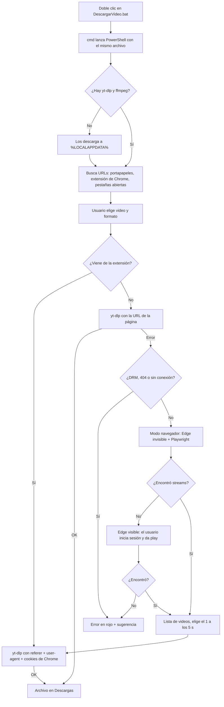

# Descargador de videos del navegador

Proyecto de estudio: una app de Windows hecha en **un solo archivo `.bat`** que descarga el video que estás viendo en el navegador. Por dentro combina **PowerShell**, **yt-dlp**, **ffmpeg**, **Python + Playwright** y una **extensión de Chrome**.

La idea del repositorio no es solo la herramienta, sino entender **por qué funciona**: cómo viaja un video por la web, dónde se puede "atrapar" y qué piezas de Windows permiten automatizarlo.

> **Uso responsable.** Descargá solo contenido propio, libre o que tengas permiso de guardar (por ejemplo, clases de un curso que compraste y que la plataforma permite ver sin conexión). Respetá los términos de cada sitio y los derechos de autor. Esta herramienta **no** rompe protecciones DRM y no está pensada para eso.

---

## Qué hace

- Detecta solo el video: lee la URL copiada en el portapapeles y la pestaña activa de Chrome, Edge, Brave, Opera, Vivaldi o Firefox.
- Descarga en **MP4** (mejor calidad, 1080p, 720p, 480p), **WEBM**, **MKV**, **MP3** o **M4A**, o en un formato elegido a mano.
- Guarda en la carpeta **Descargas** del usuario.
- Muestra los errores en rojo con el formato de PowerShell, más una sugerencia en español.
- **Modo navegador**: si `yt-dlp` no reconoce la página, abre la página en Edge, le da play al video y captura la dirección real del stream.
- **Extensión de Chrome**: captura el video desde *tu* Chrome, con tu sesión iniciada, y se lo pasa a la app por el portapapeles.
- Las preguntas importantes se responden solas a los 5 segundos con la opción recomendada.
- Si faltan `yt-dlp` o `ffmpeg`, los descarga la primera vez.

## Uso rápido

1. Descargá `DescargarVideo.bat` y hacé doble clic.
2. **Paso 1:** elegí el video (Enter = el primero de la lista) o pegá una URL.
3. **Paso 2:** elegí el formato (Enter = MP4 en la mejor calidad).
4. Si la página no es compatible, la app entra sola en **modo navegador**.

Opciones extra del menú:

| Tecla | Qué hace |
|---|---|
| `1b` | Va directo al modo navegador con la opción 1 |
| `x` | Muestra cómo instalar la extensión de Chrome |
| `c` | Usa las cookies de un navegador (Firefox es el más confiable) |
| `u` | Actualiza `yt-dlp` |
| `s` | Sale |

### Requisitos

- Windows 10 u 11 con PowerShell 5.1 (viene incluido).
- `yt-dlp` y `ffmpeg`: si no están, la app los descarga.
- Para el modo navegador: Python 3 con Playwright (si falta Playwright, la app lo instala con `pip`) y Microsoft Edge (viene con Windows).
- Para la extensión: Google Chrome con el modo desarrollador activado.

---

## Fundamentos: cómo es posible descargar videos del navegador

### 1. Cómo llega un video a tu navegador

Para el navegador, un video no es un objeto mágico: son **pedidos HTTP** como cualquier otro. Lo que cambia es *cómo* está empaquetado:

| Forma de entrega | Qué baja el navegador | ¿Se puede descargar? |
|---|---|---|
| **Archivo progresivo** | Un único `.mp4` / `.webm`, a veces por partes (`Range: bytes=…`) | Sí, la URL es el video entero |
| **HLS** (Apple, el más común) | Una lista `.m3u8` que apunta a cientos de segmentos `.ts` / `.m4s` de pocos segundos | Sí: se baja la lista, todos los segmentos y se unen |
| **DASH** | Un manifiesto `.mpd` (XML) con pistas de video y audio separadas | Sí, igual que HLS |
| **Con DRM** (Widevine, PlayReady, FairPlay) | Segmentos **cifrados**; la clave la entrega un servidor de licencias al módulo seguro del navegador | **No.** El contenido está cifrado a propósito |

¿Por qué no alcanza con "clic derecho → Guardar video"? Porque los reproductores modernos usan **Media Source Extensions (MSE)**: el JavaScript de la página baja los segmentos y se los va "inyectando" al elemento `<video>`. Por eso el `src` del video aparece como `blob:https://...`, una dirección que **solo existe en la memoria de esa pestaña**. No sirve copiarla.

La clave de todo el proyecto es esta: **aunque el `<video>` diga `blob:`, por la red pasan pedidos reales a un `.m3u8`, `.mpd` o `.mp4`**. Si atrapás esa dirección, podés pedirla de nuevo desde afuera del navegador.

### 2. yt-dlp: el motor de descarga

[`yt-dlp`](https://github.com/yt-dlp/yt-dlp) es un programa de línea de comandos con **más de 1.000 "extractores"**: uno por sitio (YouTube, Vimeo, Wistia, TikTok…). Cada extractor sabe leer la página o la API de su sitio y encontrar los streams.

Cuando no hay un extractor específico, usa el **extractor genérico**, que busca `<video>`, iframes conocidos y enlaces a `.m3u8` en el HTML. Si el video se carga con JavaScript después, el HTML no lo muestra y aparece el famoso:

```
ERROR: Unsupported URL: https://...
```

Ese error es el que dispara el **modo navegador** (sección 6).

Los parámetros que usa la app, explicados:

```text
-f "bv*+ba/b"            mejor video + mejor audio; si no hay separados, el mejor combinado
-S "res:720,ext:mp4:m4a" ordena: hasta 720p, prefiriendo mp4 y audio m4a
--merge-output-format mp4  une video y audio en un .mp4
-x --audio-format mp3      extrae solo el audio y lo convierte
--no-playlist              baja solo el video, no la lista entera
-P <carpeta> -o <plantilla>  dónde y con qué nombre guardar
--print-to-file after_move:filepath <archivo>   anota la ruta final (para "abrir carpeta")
```

### 3. ffmpeg: unir y convertir

Los sitios grandes mandan el video y el audio **por separado** (por ejemplo `1080p sin sonido` + `audio 128k`). `yt-dlp` baja las dos pistas y le pide a [`ffmpeg`](https://ffmpeg.org/) que las **remuxee**: las pone juntas en un contenedor `.mp4` o `.mkv` **sin recodificar**, por eso es rápido y no pierde calidad. ffmpeg también convierte a MP3 y arregla los streams HLS (de `MPEG-TS` a `MP4`).

### 4. El truco del archivo políglota: un `.bat` que también es PowerShell

Un `.bat` solo entiende comandos de `cmd`, que son muy limitados. El archivo empieza así:

```bat
<# :
@echo off
set "DV_SCRIPT=%~f0"
powershell -NoProfile -ExecutionPolicy Bypass -Command "iex ([IO.File]::ReadAllText($env:DV_SCRIPT, [Text.Encoding]::UTF8))"
exit /b
#>
# ... de acá para abajo, PowerShell puro ...
```

- Para **cmd**, la primera línea `<# :` es una *etiqueta* (empieza con `:`), así que la ignora. Ejecuta las líneas siguientes y en `exit /b` termina, sin llegar nunca al resto del archivo.
- Para **PowerShell**, `<# ... #>` es un **comentario de bloque**: se salta toda la parte de cmd y ejecuta el resto.
- El `.bat` se lee a sí mismo (`%~f0` es su propia ruta) y le pasa todo el texto a PowerShell con `iex` (`Invoke-Expression`).

Así se obtiene la comodidad de un `.bat` (doble clic, sin tocar la política de ejecución de scripts) con toda la potencia de PowerShell y .NET. Dentro del mismo archivo viajan, como *here-strings* (`@' … '@`), el script de Python y la extensión de Chrome, que la app escribe en `%LOCALAPPDATA%\DescargadorVideos` al arrancar.

### 5. Leer la pestaña abierta con UI Automation

¿Cómo sabe la app qué página tenés abierta, si no hay una API para "preguntarle" a Chrome? Usa **UI Automation**, la tecnología de accesibilidad de Windows que usan los lectores de pantalla:

```powershell
Add-Type -AssemblyName UIAutomationClient, UIAutomationTypes
$root = [System.Windows.Automation.AutomationElement]::FromHandle($proceso.MainWindowHandle)
$edit = $root.FindFirst('Descendants', <condición: ControlType = Edit>)   # la barra de direcciones
$url  = $edit.GetCurrentPattern([System.Windows.Automation.ValuePattern]::Pattern).Current.Value
```

Los navegadores exponen su barra de direcciones como un control *Edit* accesible, y su texto es la URL de la pestaña activa. El portapapeles se lee con `System.Windows.Forms.Clipboard`.

### 6. Modo navegador: escuchar la red con Playwright

Cuando `yt-dlp` no encuentra el video, la app hace lo mismo que harías vos con **F12 → Red**, pero automatizado:

1. Abre la página en **Microsoft Edge** controlado por [Playwright](https://playwright.dev/python/) (`channel="msedge"`), sin mostrar la ventana.
2. Se suscribe a **todas las respuestas de red** (`context.on("response", ...)`).
3. Hace clic en los botones de play típicos (`.vjs-big-play-button`, `.plyr__control--overlaid`, `.jw-icon-display`…) y ejecuta `video.play()` en cada `<iframe>`.
4. Clasifica cada respuesta por su **Content-Type** y su extensión:

   | Señal | Se interpreta como |
   |---|---|
   | `application/vnd.apple.mpegurl` o `.m3u8` | Stream HLS. Si el texto contiene `#EXT-X-STREAM-INF`, es la **lista maestra** con todas las calidades |
   | `application/dash+xml` o `.mpd` | Stream DASH |
   | `video/*` o `.mp4` / `.webm` (descartando segmentos `.ts`/`.m4s` y archivos de menos de 300 KB) | Archivo de video. El tamaño sale de `Content-Range` o `Content-Length` |
   | iframe de Vimeo, Wistia, YouTube, Bunny, etc. | Reproductor incrustado que `yt-dlp` sí conoce |

5. Guarda las **cookies** de la sesión en formato Netscape (el que entiende `yt-dlp`) y ordena los resultados: la lista maestra HLS primero.

Si no encuentra nada (porque el sitio pide iniciar sesión o un clic humano), abre Edge **visible**. Ahí iniciás sesión y le das play vos; al cerrar la ventana, la app descarga lo que capturó. El perfil de Edge queda guardado, así que la sesión se recuerda para la próxima.

### 7. La extensión de Chrome: por qué hace falta

Lo ideal sería usar directamente tu Chrome, que ya tiene tu sesión iniciada, pero Chrome lo impide a propósito:

- Desde **Chrome 127**, las cookies se cifran con *App-Bound Encryption*: solo Chrome puede descifrarlas, así que `yt-dlp --cookies-from-browser chrome` falla.
- Desde **Chrome 136**, el perfil principal no acepta control remoto (`--remote-debugging-port`), para frenar el robo de sesiones por malware.

La solución legítima es una **extensión**, que corre *dentro* de Chrome con los permisos que vos le das:

```json
"permissions": ["webRequest", "cookies", "storage", "clipboardWrite"],
"host_permissions": ["<all_urls>"]
```

- `chrome.webRequest.onHeadersReceived` le permite **observar** (no modificar) los encabezados de cada respuesta y aplicar la misma clasificación de la sección 6, pestaña por pestaña. El ícono muestra cuántos videos detectó.
- Al tocar **Copiar para el descargador**, junta las cookies de esa página con `chrome.cookies.getAll()` y copia al portapapeles un JSON:

  ```json
  {"dv":1,"url":"https://.../master.m3u8","kind":"hls","page":"https://...","title":"...","ua":"Mozilla/5.0 ...","cookies":"# Netscape HTTP Cookie File\n..."}
  ```

- La app reconoce ese JSON en el portapapeles y lo muestra como opción 1. El portapapeles funciona como **puente** entre la extensión y el programa, sin servidores ni registro de Windows de por medio.

### 8. Referer, User-Agent y cookies: por qué hacen falta

Muchos servidores de video no entregan el stream a cualquiera. Revisan:

- **Cookies**: prueban que tenés la sesión iniciada (cursos, contenido de suscripción).
- **`Referer`**: la página desde la que se pide el video. Muchos CDN rechazan el pedido (`HTTP 403`) si no viene de su propio sitio.
- **`User-Agent`**: algunos bloquean clientes que no parecen un navegador.

Por eso, cuando la app usa una dirección capturada, se la pasa a `yt-dlp` con `--referer`, `--user-agent` y `--cookies`: el pedido se ve igual al que hizo el navegador.

### 9. Errores con formato de PowerShell

`yt-dlp` escribe el progreso en la **salida estándar** (stdout) y los errores en la **salida de error** (stderr). La app lo ejecuta así:

```powershell
$p = Start-Process -FilePath yt-dlp.exe -ArgumentList $args -NoNewWindow -Wait -PassThru `
                   -RedirectStandardError $archivoErrores
```

- El progreso se ve en vivo, porque stdout no se redirige.
- Los errores quedan en un archivo; al terminar se separan los `WARNING` (en amarillo) de los `ERROR` (en rojo).
- `$p.ExitCode` distinto de 0 significa que falló.
- Un `switch -Regex` traduce el error técnico a una sugerencia (`Unsupported URL` → modo navegador, `HTTP Error 403` → cookies o actualizar, `DRM` → no se puede).

Con PowerShell 5.1 conviene **no** usar `2>&1` con programas externos: envuelve cada línea en un `ErrorRecord` y ensucia la salida.

### 10. Una cuenta regresiva que no bloquea

`Read-Host` espera para siempre. Para que una pregunta se responda sola, la app consulta el teclado sin bloquearse:

```powershell
while (-not $respuesta) {
    if ([Console]::KeyAvailable) { $tecla = [Console]::ReadKey($true) }   # ¿hay una tecla esperando?
    # ... si se acabó el tiempo, $respuesta = $Default
    Start-Sleep -Milliseconds 50
}
```

Antes de preguntar, vacía las teclas acumuladas (para que lo que apretaste durante la descarga no responda sin querer). Si la entrada viene redirigida, por ejemplo en pruebas automáticas, vuelve a `Read-Host`.

---

## Flujo completo



## Mapa del código

Todo está en `DescargarVideo.bat`, en este orden:

| Sección | Qué contiene |
|---|---|
| Cabecera `<# : … #>` | Lanzador de cmd (sección 4) |
| `$SnifferCode` | Script Python con Playwright que escucha la red (sección 6) |
| `$ExtFiles` | `manifest.json`, `background.js`, `popup.html` y `popup.js` de la extensión (sección 7) |
| `Show-Error`, `Read-Timeout` | Pantalla de errores y cuenta regresiva (secciones 9 y 10) |
| `Get-Tool`, `Install-YtDlp`, `Install-Ffmpeg`, `Get-PythonPlaywright` | Dependencias |
| `Get-BrowserUrls`, `Get-ClipboardUrl`, `Get-ClipboardCapture` | Detección de URLs (sección 5) |
| `$Formatos` | Los formatos y sus parámetros de `yt-dlp` (sección 2) |
| `Invoke-YtDlp`, `Start-Download`, `Get-Hint` | Ejecución y errores (sección 9) |
| `Invoke-BrowserMode`, `Start-CapturedDownload` | Modo navegador y descarga con cookies (secciones 6 y 8) |
| `PROGRAMA PRINCIPAL` | El menú |

Al ejecutarse, la app crea `%LOCALAPPDATA%\DescargadorVideos\` con `bin\` (yt-dlp/ffmpeg si los descargó), `perfil-navegador\` (el perfil de Edge), `extension-chrome\` y archivos temporales.

## Límites conocidos

- **DRM**: Netflix, Disney+, Prime Video, Max, etc. no se pueden descargar. Es una limitación intencional.
- **Publicidad**: si el sitio muestra un anuncio en video, puede aparecer en la lista. Suele ser el más corto.
- **Sitios que cambian**: los extractores de `yt-dlp` se rompen cuando un sitio cambia; se arregla actualizando (`u`).
- **Extensión sin publicar**: se instala en modo desarrollador y Chrome puede mostrar un aviso al iniciar.
- **Solo Windows**: usa PowerShell 5.1, UI Automation y rutas de Windows.

## Para seguir estudiando

- Abrí cualquier video, apretá **F12 → Red**, filtrá por `m3u8` y mirá cómo el reproductor pide la lista maestra y después los segmentos.
- Abrí un `.m3u8` en el navegador: es texto plano. Mirá `#EXT-X-STREAM-INF` (calidades) y `#EXTINF` (duración de cada segmento).
- Probá `yt-dlp -F <url>` para ver todos los formatos que ofrece un video, y `yt-dlp -v <url>` para ver qué hace paso a paso.
- Leé la documentación de [`chrome.webRequest`](https://developer.chrome.com/docs/extensions/reference/api/webRequest) y de [Media Source Extensions](https://developer.mozilla.org/es/docs/Web/API/Media_Source_Extensions_API).

## Licencia

[MIT](LICENSE). `yt-dlp` (Unlicense), `ffmpeg` (LGPL/GPL) y Playwright (Apache 2.0) tienen sus propias licencias y no están incluidos en este repositorio: la app los descarga o usa los que ya están instalados.
